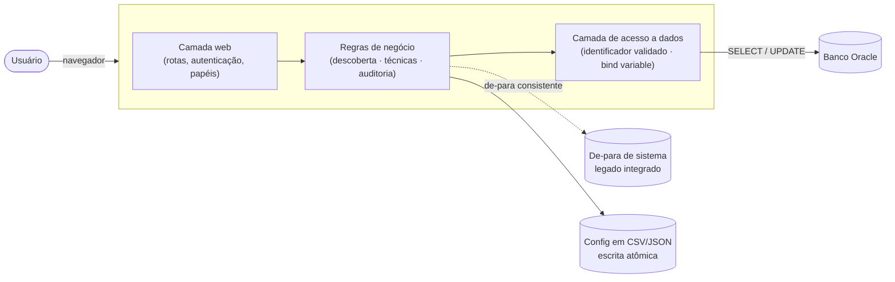

# 🛡️ DataMask

### Anonimização de dados sensíveis (LGPD) em bancos Oracle

Projetada e desenvolvida sozinha, do zero até produção, como DBA.

 

> [!IMPORTANT]
> A DataMask foi construída para uso interno da empresa onde trabalho — o **código-fonte é propriedade da empresa e não está público**. Este README descreve o problema, a solução e as decisões técnicas do projeto, como material de portfólio.

## 📌 Índice

- [O problema](#-o-problema)
- [O que a ferramenta faz](#-o-que-a-ferramenta-faz)
- [Como funciona](#-como-funciona)
- [Stack técnica](#-stack-técnica)
- [Decisões técnicas que valem destacar](#-decisões-técnicas-que-valem-destacar)
- [Meu papel](#-meu-papel)

## 🎯 O problema

Antes da ferramenta, mascarar dados sensíveis fora de produção era um processo **manual, inconsistente e sem rastreabilidade**: cada pessoa decidia na hora o que mascarar e como, sem garantia de que campos relacionados (como um CPF que aparece em várias tabelas) ficassem consistentes entre si, e sem nenhum histórico de quem fez o quê.

## ✨ O que a ferramenta faz

| | |
|---|---|
| 🔍 **Descoberta automática** | Cruza o nome da coluna, o comentário cadastrado nela no Oracle (`COMMENT ON COLUMN`) e uma amostra dos dados reais pra sugerir a técnica certa, com nível de confiança. |
| 🎭 **25+ técnicas de mascaramento** | Dado fictício plausível (nome, CPF, e-mail, endereço, cartão, placa...), hash determinístico, ruído numérico, embaralhamento entre linhas, generalização de data, redação de padrões dentro de texto livre, entre outras. |
| 🔗 **Consistência garantida** | O mesmo valor original sempre vira o mesmo valor mascarado, em qualquer tabela ou execução — essencial pra não quebrar o relacionamento entre tabelas. |
| 🌐 **Consistência entre sistemas integrados** | Suporte a importar o de-para que um sistema legado já gera pro próprio processo de anonimização dele, e reaproveitar os mesmos valores no Oracle — evita que a mesma pessoa fique com dois valores fictícios diferentes em sistemas que trocam dado entre si. |
| 🧩 **Integridade referencial** | Avisa quando uma coluna mascarada é referenciada por chave estrangeira em outra tabela com técnica diferente (ou nenhuma), com correção num clique. |
| ⚙️ **Mascaramento condicional e incremental** | Aplica uma técnica só quando outra coluna da mesma linha bate uma condição, e processa só as linhas novas desde a última execução. |
| 👀 **Prévia antes de gravar** | Valor original ao lado do valor que vai substituí-lo, linha por linha, antes de qualquer escrita real — com aviso automático de valor maior que a coluna de destino. |
| 💾 **Backup automático opcional** | Salva uma cópia das linhas que serão alteradas numa tabela separada antes de gravar, como rede de segurança rápida. |
| 📝 **Auditoria completa** | Toda execução e toda mudança de configuração (quem, quando, o quê) fica registrada. |
| 🔐 **Controle de acesso por papel e por banco** | Administrador x usuário comum, com escopo de acesso restrito a bancos específicos quando necessário. |
| ⏰ **Agendamento automático** | Execuções recorrentes sem depender de agendador externo. |
| 📊 **Relatório de conformidade** | Cobertura por banco/schema, distribuição por técnica, e alerta pra regra cadastrada que nunca chegou a rodar de verdade. |

## 🏗️ Como funciona

Fluxo de uso, sempre nessa ordem: **descobrir → configurar a técnica → revisar a prévia → confirmar a gravação**.

## 🧰 Stack técnica

| Camada | Tecnologia |
|---|---|
| Linguagem | Python 3.12 |
| Framework web | Flask |
| Driver de banco | python-oracledb (modo *thin*, sem cliente Oracle instalado) |
| Dados fictícios | Faker |
| Agendamento | APScheduler |
| Frontend | HTML/CSS/JS servidos pelo próprio servidor (sem framework nem build step) |
| Configuração | CSV/JSON com escrita atômica e lock de concorrência (sem banco próprio) |
| Testes | pytest — **358 casos automatizados**, com o Oracle sempre simulado |

## 🔒 Decisões técnicas que valem destacar

- **Sem banco de dados próprio, de propósito** — toda a configuração vive em CSV/JSON, com escrita atômica (arquivo temporário + substituição) e lock de concorrência: evita a complexidade operacional de manter um banco só pra guardar configuração de uma ferramenta interna, sem abrir mão de segurança contra corrupção de dado em escrita concorrente.
- **Segurança de acesso ao Oracle** — todo identificador (schema/tabela/coluna) usado pra montar uma consulta é validado por expressão regular antes de entrar no SQL, nunca concatenado como texto livre. Todo valor de dado trafega como *bind variable*.
- **Anonimização de mão única por padrão** — nenhuma técnica guarda forma de reverter ao dado original; o cache que garante consistência guarda as chaves como hash HMAC, nunca o dado real em texto puro.
- **Prevenção automática de colisão** — quando uma técnica de substituição gera um valor que por acaso já está em uso, a ferramenta tenta gerar de novo sozinha antes de desistir, evitando erro de violação de chave única no banco.
- **Desenvolvimento orientado a teste** — cada módulo de regra de negócio tem sua própria suíte, sempre com o Oracle simulado: a suíte inteira roda sem precisar de banco real, o que permitiu evoluir e refatorar com confiança ao longo de várias rodadas de revisão de segurança e desempenho.

## 👩‍💻 Meu papel

Projetei, desenvolvi e mantenho essa ferramenta **sozinha**, como DBA — da concepção inicial até rodadas sucessivas de revisão de segurança, desempenho e usabilidade, incluindo testes *end-to-end* contra um ambiente Oracle real antes de cada entrega.

 

**Natália Vieira** · DBA

